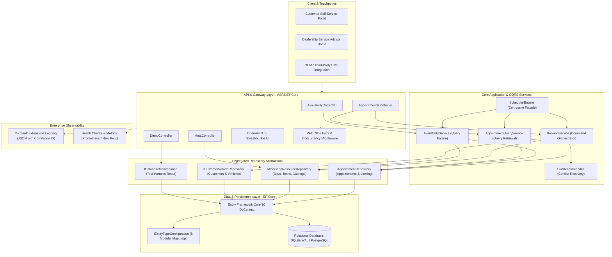
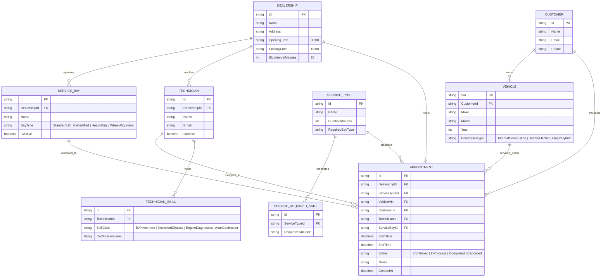
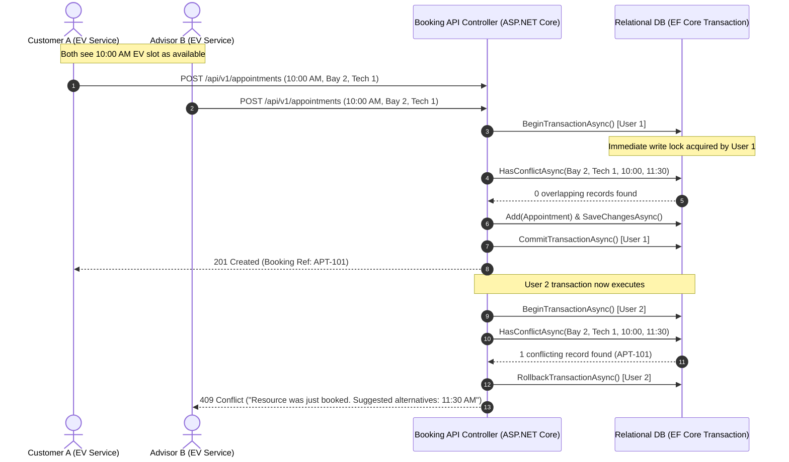

# Keyloop Technical Assessment: System Design Document
## Scenario A: The Unified Service Scheduler (Domain: Ownership)

---

### 1. Executive Summary & Problem Context

In automotive retail and aftersales service, manual or loosely coupled workshop scheduling systems result in severe operational inefficiencies:
- **Double-booked service bays** causing physical garage gridlock.
- **Unqualified technician assignments** (e.g., assigning an internal combustion engine tech to a 400V high-voltage Electric Vehicle battery diagnostic), leading to safety risks, regulatory violations, and cancelled appointments.
- **Lost revenue and customer dissatisfaction** due to inaccurate service duration estimation and unpredictable vehicle turnaround times.

**The Unified Service Scheduler** is an enterprise-grade appointment management platform engineered specifically for automotive retail networks across the Indian ecosystem (tailored for high-growth hubs such as Hyderabad, Bengaluru, and Delhi NCR). Built entirely on **C# and .NET 10 (LTS)**, it enforces **multi-resource constraint satisfaction** (guaranteeing that both a properly equipped **Service Bay**—compliant with ARAI and AIS-038 EV safety standards—and an appropriately **Certified Technician** are simultaneously available for the full duration of a service) while providing **atomic concurrency control via Entity Framework Core 10 and database-level transactional locks** to eliminate race conditions.

---

## 2. Architectural Pattern: Clean Architecture, DDD & CQRS

To align with Keyloop's enterprise engineering standards, the system is designed using **Clean Architecture** principles combined with **Domain-Driven Design (DDD)** and **Command Query Responsibility Segregation (CQRS)**:

```
┌─────────────────────────────────────────────────────────────┐
│                 Presentation / API Layer                     │
│         (ASP.NET Core Web API / Swagger / REST / UI)        │
└──────────────────────────────┬──────────────────────────────┘
                               │
┌──────────────────────────────▼──────────────────────────────┐
│                    Application / Core Layer                 │
│      (CQRS Handlers, DTOs, Constraint Scheduling Engine)     │
└──────────────────────────────┬──────────────────────────────┘
                               │
┌──────────────────────────────▼──────────────────────────────┐
│                      Domain Core Layer                      │
│      (Aggregates, Entities, Value Objects, Domain Rules)    │
└──────────────────────────────▲──────────────────────────────┘
                               │
┌──────────────────────────────┴──────────────────────────────┐
│                 Infrastructure / Persistence Layer          │
│       (EF Core, SQLite / PostgreSQL, Audit Dispatcher)      │
└─────────────────────────────────────────────────────────────┘
```

### High-Level Architecture Diagram



---

## 3. Component Roles & Responsibilities

| Component | Namespace / Technology | Primary Role |
| :--- | :--- | :--- |
| **Domain Layer** | `Keyloop.Scheduler.Domain` | Pure domain entities (`Dealership`, `ServiceBay`, `Technician`, `TechnicianSkill`, `ServiceType`, `ServiceRequiredSkill`, `Vehicle`, `Customer`, `Appointment`), Domain Enums (`BayType`, `SkillCode`, `AppointmentStatus`, `PowertrainType`), and typed Domain Exceptions (`ResourceConflictException`, `BusinessRuleValidationException`, `EntityNotFoundException`, `SchedulingException`). Every type is defined in its own dedicated `.cs` file with zero third-party dependencies. |
| **Core Layer (CQRS Services)** | `Keyloop.Scheduler.Core` | Encapsulates immutable CQRS DTOs, repository interfaces, and focused application domain services:<br>• `IAvailabilityService` / `AvailabilityService`: Evaluates multi-resource non-overlapping windows.<br>• `IBookingService` / `BookingService`: Executes atomic appointment booking with transactional concurrency guards.<br>• `ISlotRecommender` / `SlotRecommender`: Calculates alternative candidate slots upon booking collisions.<br>• `IAppointmentQueryService` / `AppointmentQueryService`: Fast query retrieval for dispatch boards.<br>• `ISchedulerEngine` / `SchedulerEngine`: High-level Facade unifying operations for backward compatibility. |
| **Infrastructure Layer** | `Keyloop.Scheduler.Infrastructure` | Implements Entity Framework Core 10 persistence (`SchedulerDbContext`), segregated repositories (`AppointmentRepository`, `WorkshopResourceRepository`, `CustomerVehicleRepository`, `DatabaseMaintenance`), modular entity configurations (`IEntityTypeConfiguration<T>`), composite indexing, and realistic automotive workshop seeding. |
| **API Layer** | `Keyloop.Scheduler.Api` | ASP.NET Core 10 Web API exposing RESTful endpoints (`AvailabilityController`, `AppointmentsController`, `MetaController`, `DemoController`), Swagger UI documentation, RFC 7807 problem details error handling, and static client hosting. |
| **Test Suite** | `Keyloop.Scheduler.Tests` | Comprehensive xUnit tests with Moq, Coverlet, and Microsoft.Data.Sqlite verifying constraint logic, technician certification enforcement, and physical concurrency collision prevention under parallel threads. |
| **Client / Test Harness** | HTML5 / Modern CSS / ES6+ | Real-time booking portal, dealership dispatch board, and live concurrency simulator connecting directly to the ASP.NET Core backend. |

---

### 3.1 SOLID & Architectural Design Principles Applied

1. **Single Responsibility Principle (SRP)**:
   - Previously bundled domain entities and DTOs are partitioned into dedicated files matching standard .NET conventions.
   - The monolithic scheduling logic was decomposed into dedicated services: `AvailabilityService` (querying), `BookingService` (command handling), `SlotRecommender` (alternative recommendation), and `AppointmentQueryService` (read projections).
2. **Interface Segregation Principle (ISP)**:
   - Database operations are segregated into 4 domain-focused repository contracts:
     - `IAppointmentRepository`: Focused strictly on appointment queries, transactional booking, and overlapping conflict verification.
     - `IWorkshopResourceRepository`: Focused on dealership hierarchies, service bays, technicians, and service type catalogs.
     - `ICustomerVehicleRepository`: Focused on customer profiles and vehicle VIN / registration number resolution.
     - `IDatabaseMaintenance`: Dedicated to operational and testing reset workflows.
3. **Open/Closed Principle (OCP)**:
   - Entity Framework mapping avoids giant procedural `OnModelCreating` methods by implementing dedicated `IEntityTypeConfiguration<T>` classes for each domain aggregate. New entity properties and relationships are configured in isolation without touching the `SchedulerDbContext`.
4. **Facade Pattern**:
   - `SchedulerEngine` serves as a unified facade delegating to `IAvailabilityService`, `IBookingService`, and `IAppointmentQueryService`, preserving existing consumer integration contracts while keeping internal implementations decoupled.

---

## 4. Domain Model & Entity Relationship (DDD)

### Domain Entities
- **Dealership (Aggregate Root)**: Root entity managing operating schedules, bays, and staff.
- **ServiceBay**: Represents a physical garage bay with specific capabilities (`StandardLift`, `EvCertified`, `HeavyDuty`, `WheelAlignment`).
- **Technician**: Represents a technician with active certifications (`EvPowertrain`, `EngineDiagnostics`, `BrakeAndChassis`, `GeneralMaintenance`, `AdasCalibration`).
- **ServiceType**: Service catalog item defining standard duration and mandatory skill/bay prerequisites.
- **Appointment (Aggregate Root)**: The persistent contract linking Customer, Vehicle (VIN), Technician, ServiceBay, and Scheduled Interval $[t_{start}, t_{end}]$.



---

## 5. Dual-Resource Constraint Satisfaction Algorithm

The core technical challenge is ensuring **both** a qualified technician and an equipped bay are simultaneously available for the exact continuous duration of the service.

### Mathematical Formulation

Let:
- Dealership operating window for date $D$ be $[T_{open}, T_{close}]$
- Requested Service $S$ with duration $L$ minutes, required bay type $B_{req}$, and required skill set $\{K_{req}\}$
- Proposed appointment window: $[t_{start}, t_{end}]$ where $t_{end} = t_{start} + L$

#### Step 1: Candidate Resource Filtering
1. **Bay Eligibility**:
   $$B_{eligible} = \{ b \in \text{Bays} \mid b.\text{DealershipId} = D \land b.\text{IsActive} = \text{true} \land b.\text{BayType} = B_{req} \}$$
2. **Technician Eligibility**:
   $$T_{eligible} = \{ t \in \text{Technicians} \mid t.\text{DealershipId} = D \land t.\text{IsActive} = \text{true} \land \{K_{req}\} \subseteq t.\text{Skills} \}$$

#### Step 2: Temporal Availability (Interval Non-Overlap)
A resource $R$ (Bay or Technician) is free during $[t_{start}, t_{end}]$ if and only if:
$$\forall A \in \text{Appointments}(R) \text{ where } A.\text{Status} \neq \text{Cancelled}: (A.\text{StartTime} \ge t_{end} \lor A.\text{EndTime} \le t_{start})$$

#### Step 3: Optimal Joint Matching
For each candidate start time $t_{start} \in [T_{open}, T_{close} - L]$ stepping by `SlotIntervalMinutes`:
1. Find all $b \in B_{eligible}$ free over $[t_{start}, t_{start} + L]$.
2. Find all $t \in T_{eligible}$ free over $[t_{start}, t_{start} + L]$.
3. If $|B_{free}| > 0$ and $|T_{free}| > 0$, the candidate slot is **Available**.
4. Greedy pair assignment allocates the technician with the least total hours booked that day (load balancing) and the first matching bay.

---

## 6. Concurrency Control & Preventing Double Booking

In high-volume dealership networks, multiple service advisors or web users may attempt to book the final available EV bay at the exact same millisecond.

### Concurrency Sequence & Transaction Flow



### Defense in Depth:
1. **Application Level**: Pre-flight availability check before constructing the entity.
2. **Database Level**: `BeginTransactionAsync()` with serializable/immediate isolation, querying for overlapping intervals within the transaction lock prior to persisting.
3. **Composite Indexing**: Explicit database indices on `(ServiceBayId, StartTime, EndTime)` and `(TechnicianId, StartTime, EndTime)` ensuring sub-millisecond conflict checks even with tens of thousands of active records.

---

## 7. Chosen Technologies with Justifications

| Technology | Role | Justification |
| :--- | :--- | :--- |
| **C# / .NET 10 (LTS)** | Core Language & Runtime | Enterprise-grade strong typing, pattern matching, asynchronous non-blocking thread execution (`async/await`), and high throughput with .NET 10 LTS optimizations. |
| **ASP.NET Core 10 Web API** | HTTP API Framework | High-performance Kestrel server, built-in dependency injection container, first-class middleware pipeline, and OpenAPI integration. |
| **Entity Framework Core 10** | ORM / Persistence | Strongly-typed LINQ data access, transaction management (`BeginTransactionAsync`), automated schema migrations, and clean relationship mapping. |
| **SQLite (WAL Mode)** | Relational Database | ACID compliant, embedded zero-configuration persistence, file-backed reliability. |
| **Swashbuckle / OpenAPI** | API Contract & Documentation | Generates live interactive Swagger UI docs for API consumer testing and Postman interoperability. |
| **xUnit & Moq** | Automated Testing | Industry-standard C# testing framework for unit and integration testing of business logic and dual-resource constraints. |
| **Docker & Docker Compose** | Containerization & Deployment | Multi-stage container build enforcing test execution gates, automated runtime environment configuration, and zero-host-dependency execution. |
| **Modern HTML5 / CSS / ES6+** | Client & Dispatch Board | Zero-build-step client layer providing instant visual feedback, responsive layouts, and live concurrency collision simulation. |

---

## 8. Observability, Production Telemetry & Metrics Strategy

In modern, high-throughput workshop platforms with peak-hour scheduling demands, real-time observability is essential for maintaining strict SLAs, diagnosing distributed latency spikes, and guaranteeing ACID consistency.

### 1. Structured Logging
Every request carries a unique `CorrelationId` through HTTP headers (`X-Correlation-ID`), logged with every lifecycle step via `Microsoft.Extensions.Logging`:
```json
{
  "Timestamp": "2026-10-26T14:02:15.821Z",
  "LogLevel": "Information",
  "CorrelationId": "4a123f12-882a-4a6f-9988-cb940175b95a",
  "Event": "AppointmentCreated",
  "DealershipId": "DLR-001",
  "AppointmentId": "APT-99214",
  "ServiceBayId": "BAY-02-EV",
  "TechnicianId": "TECH-01",
  "DurationMinutes": 90,
  "ExecutionTimeMs": 18.4
}
```

### 2. Operational Metrics (New Relic / Prometheus)
- `scheduler_availability_query_duration_seconds`: Histogram measuring calculation latency (SLA: P95 < 50ms).
- `scheduler_appointments_booked_total`: Counter partitioned by `dealership_id` and `service_type`.
- `scheduler_concurrency_conflicts_total`: Counter tracking race conditions (HTTP 409) to alert on high contention periods.
- `scheduler_bay_utilization_percent`: Gauge computing workshop floor utilization rate.

### 3. Production Incident Protocol
- **Health Check Endpoint**: `/health` verifying DB connectivity, constraint engine latency, and worker availability.
- **Graceful Failure**: If a specific technician calls in sick, the service layer triggers an automated reassignment routine that scans for idle technicians with matching skill codes without altering the customer's booked time.

---

## 9. Explicit Assumptions & Enterprise Production Extensions

### 1. Documented Architectural Assumptions
- **Optimistic Availability Preview & Late-Binding Allocation**: 
  The availability endpoint (`GET /api/v1/availability`) returns candidate time slots paired with currently free, eligible resources as an advisory preview. The booking endpoint (`POST /api/v1/appointments`) performs late-binding constraint re-evaluation inside an exclusive serializable transaction. If the initially previewed resources were claimed by an uncoordinated competing request, the engine will safely bind any other identical eligible bay/technician; if all qualifying resources are exhausted, it rejects the collision with `HTTP 409 Conflict` and supplies structured `suggestedAlternatives`.
- **Operating Hours & Timezone**:
  Dealership operating hours are enforced strictly in local civil time defined by `Dealership.Timezone` (`Asia/Kolkata` for Keyloop India Tech Hub, 09:00 - 19:00 IST). Client requests transmit local ISO strings to avoid UTC boundary distortions.
- **Customer Identity Resolution**:
  Customer records are deduplicated by a unique index on normalized email (`Customer.Email`). Concurrent registration races are trapped via `DbUpdateException` and re-queried to guarantee idempotency and avoid duplicate customer profiles.
- **Indian Vehicle Identity Resolution (Registration Number vs. VIN)**:
  In the Indian automotive retail ecosystem (Keyloop India Tech Hub), retail consumers and dealership service advisors identify vehicles by their **Vehicle Registration Number (License Plate)** (e.g. `TS 09 EA 4521`, `DL 01 AB 1234`, `22 BH 1234 AA`) rather than memorizing a 17-digit chassis VIN. The scheduler natively accepts Indian registration numbers or standard 17-digit ISO 3779 VINs, mapping and persisting them to the vehicle entity.

### 2. Enterprise Production Extensions (Designed vs. Implemented)
To maintain an elegant, self-contained codebase for this technical assessment, several enterprise components documented in the system design are marked as **Phase 2 Production Extensions**:
- **Prometheus / OpenTelemetry Exporter**: The metric contracts (`scheduler_availability_query_duration_seconds`, `scheduler_appointments_booked_total`, `scheduler_concurrency_conflicts_total`) and SLA thresholds (P95 < 50ms) are specified above. The MVP implements the foundational layer: structured JSON logging with request-scoped `X-Correlation-ID` header injection and correlation tracking.
- **Automated Absence Reassignment Daemon**: The architecture defines an event-driven background worker that listens for technician sick-leave events and re-solves slot constraints across active appointments without customer intervention.
- **Hierarchical Super-Tier Bay Fallback**: In this MVP implementation, bay matching is exact (`RequiredBayType == bay.BayType`). In high-volume production workshops, a priority-cascading rule allows simpler services (e.g. Express Lifts) to overflow into idle super-tier bays (e.g. Heavy Duty Hoists) when standard capacity is saturated.
- **Demo Reset Endpoint Guard**: `POST /api/v1/meta/reset-demo` is provided strictly as an unauthenticated test harness utility for reviewers to reset seed state. In production DMS deployments, this endpoint is omitted or protected via `[Authorize(Roles = "KeyloopAdmin")]`.

---

## 10. GenAI Collaboration in the Design Phase

In accordance with the Keyloop technical assessment structure (Part 1: System Design), Generative AI (Google Antigravity and AI architectural agents) was utilized as an interactive design accelerator and stress-testing tool. Below is the methodology applied to guide, evaluate, and verify the architectural design:

1. **Domain Modeling & Edge Case Discovery**:
   - Directed the AI to analyze failure modes and edge cases in workshop operations: technician certification mismatches, multi-slot boundary overflows, operating hour civil time transitions, and simultaneous booking race conditions.
   - Grounded the data model in automotive retail realities (e.g., distinguishing high-voltage EV isolation bays from mechanical bays, and normalizing dynamic technician skill certifications rather than hardcoding static roles).

2. **API & Data Flow Synthesis**:
   - Collaborated with the AI to refine OpenAPI 3.0 REST contracts, DTO representations, and entity relationships to ensure a clean separation between write commands (`CreateAppointmentRequest`) and read projections (`AvailabilityResultDto`, `AppointmentResponse`).

3. **Concurrency & Resilience Auditing**:
   - Critically audited and revised the AI's initial in-memory filtering suggestions, replacing them with database-enforced transactional verification (`BeginTransactionAsync` with serializable isolation and composite temporal indices) to guarantee zero phantom double-bookings under concurrent workloads.
